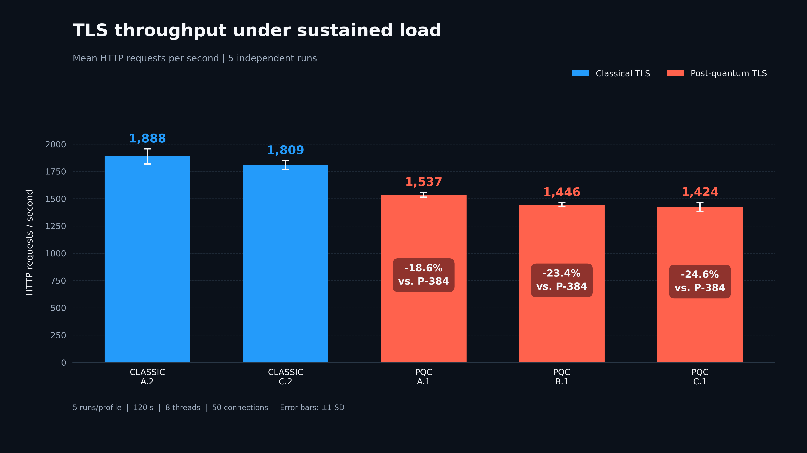
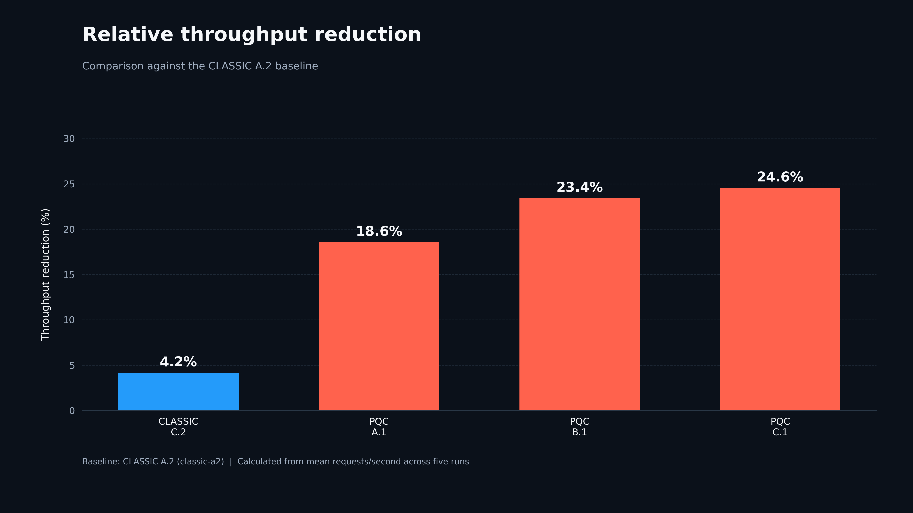
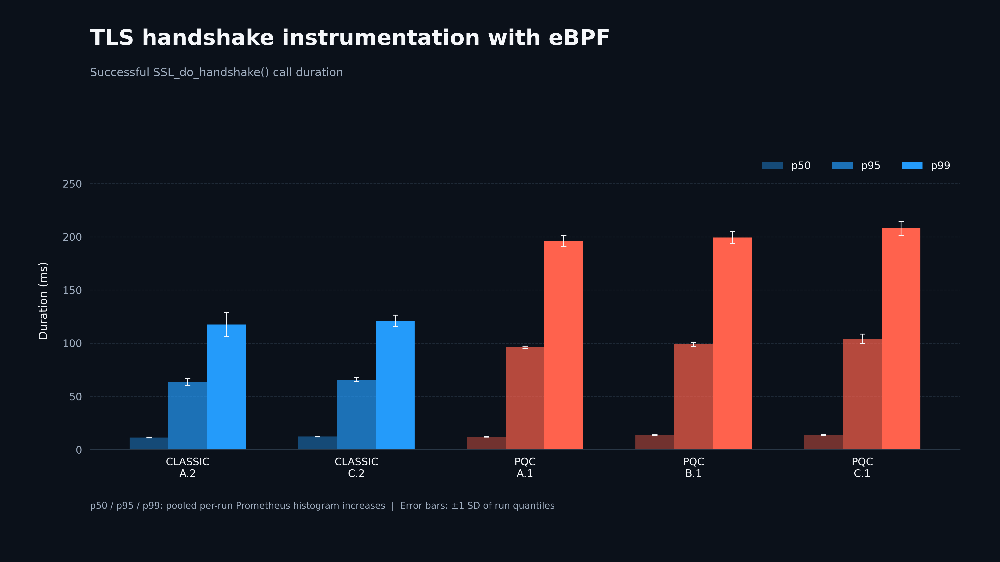
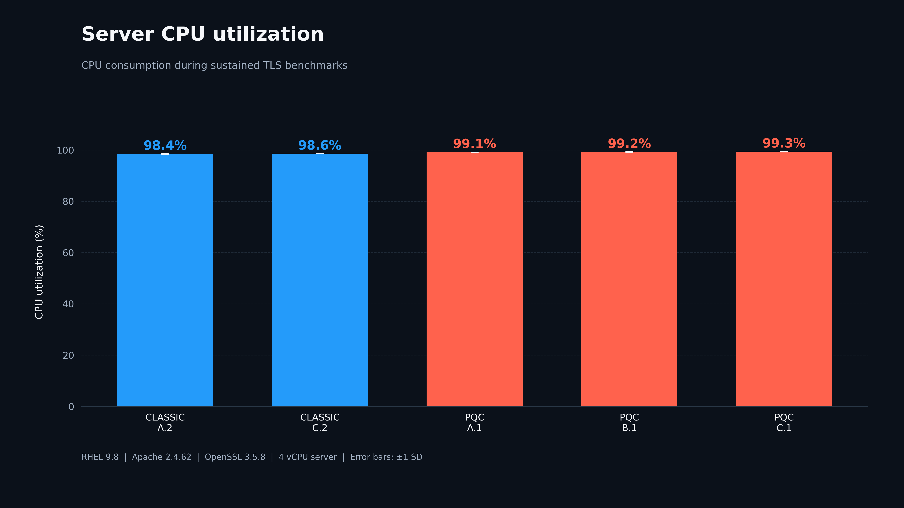
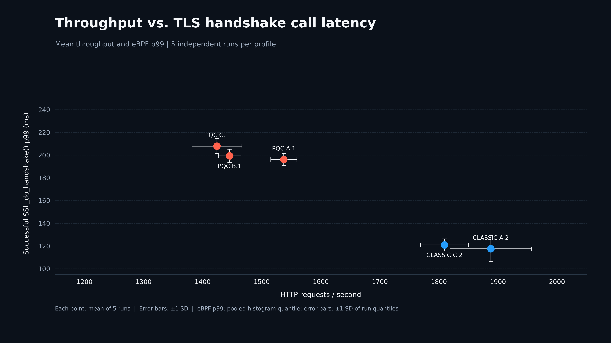
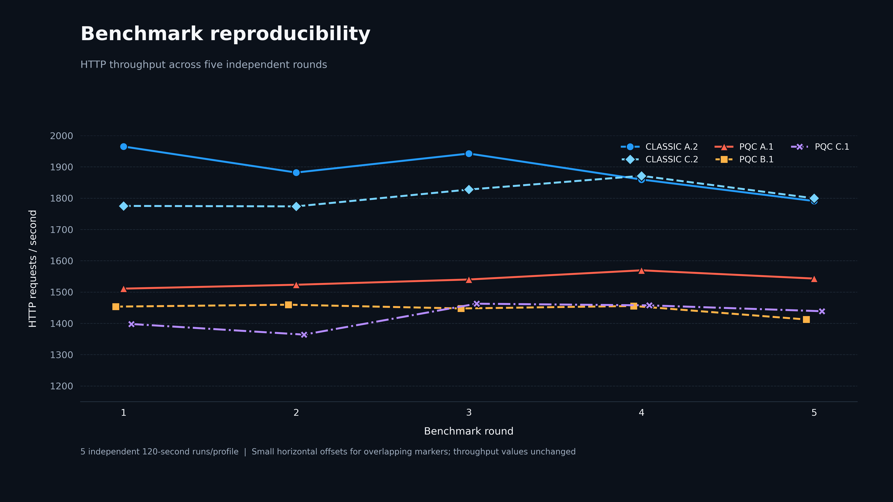
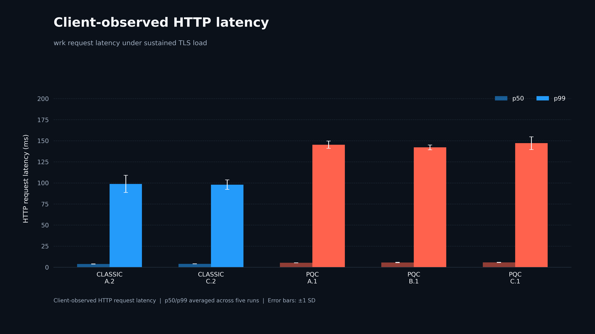

<div align="center">

# 🔐 Post-Quantum TLS: Beyond the Handshake

### **What does quantum-resistant HTTPS actually cost?**

**An experimental performance study on Red Hat Enterprise Linux**

`OpenSSL 3.5` · `Apache HTTP Server` · `wrk` · `eBPF` · `Prometheus` · `Grafana`


**[Results](#-the-results-first) · [Why it matters](#-why-this-matters) · [Architecture](#-inside-the-lab) · [Methodology](#-how-we-tested) · [Figures](#-visualizations) · [Reproduce](#-reproducing-the-study)**

</div>

---

## 📊 The results, first

> **In our near-CPU-saturated HTTPS testbed, the post-quantum TLS profiles delivered approximately 19–25% fewer requests per second than the classical A.2 baseline.**
>
> This is an observed *system-level* difference—not a universal PQC overhead figure or an isolated cryptographic benchmark.

<div align="center">

| **PQC A.1** | **PQC B.1** | **PQC C.1** |
|:---:|:---:|:---:|
| **−18.6%** | **−23.4%** | **−24.6%** |
| HTTP throughput | HTTP throughput | HTTP throughput |
| vs. `classic-a2` | vs. `classic-a2` | vs. `classic-a2` |

*November 4, 2026 stability campaign · 5 runs/profile · 120 seconds/run · 8 threads · 50 concurrent connections*

</div>

### HTTP throughput under sustained load



*Mean HTTP requests per second across five independent runs; error bars show ±1 standard deviation.*

| Profile | Scenario | Mean requests/s | Standard deviation | vs. CLASSIC A.2 |
|:--|:--|--:|--:|--:|
| **`classic-a2`** | A.2 · classical baseline | **1,887.89** | 69.25 | **Baseline** |
| `classic-c2` | C.2 · classical | 1,809.43 | 40.92 | −4.2% |
| `pqc-a1` | A.1 · post-quantum | 1,537.39 | 22.16 | −18.6% |
| `pqc-b1` | B.1 · post-quantum | 1,445.68 | 19.15 | −23.4% |
| `pqc-c1` | C.1 · post-quantum | 1,424.17 | 42.19 | −24.6% |



### Beyond throughput: TLS-call latency and CPU



*Pooled histogram estimates of successful `SSL_do_handshake()` call durations. These are not necessarily full TLS handshake durations or isolated cryptographic execution times.*

| Profile | eBPF p50 (ms) | eBPF p95 (ms) | eBPF p99 (ms) | Mean server CPU |
|:--|--:|--:|--:|--:|
| `classic-a2` | 11.34 | 63.40 | 117.60 | 98.43% |
| `classic-c2` | 12.29 | 65.75 | 120.98 | 98.56% |
| `pqc-a1` | 11.96 | 96.19 | 196.17 | 99.12% |
| `pqc-b1` | 13.58 | 99.06 | 199.35 | 99.22% |
| `pqc-c1` | 13.75 | 104.16 | 207.98 | 99.33% |

Relative to `classic-a2`, the post-quantum profiles showed approximately **67–77% higher p99 `SSL_do_handshake()` call duration** under the tested workload. CPU utilization was near saturation for all profiles. This is consistent with a resource-constrained workload, but CPU utilization alone does not isolate cryptographic cost.

**The question is not just how fast a PQC primitive executes. It's what happens to an HTTPS server when fresh TLS connections, concurrent clients, and CPU pressure meet.**

---

## 🔎 Why this matters

Post-quantum cryptography is becoming available in mainstream TLS stacks. But a microbenchmark of a signature or key-encapsulation operation cannot, by itself, predict application behavior.

This repository studies the performance of **a complete HTTPS workload** while exposing what happens inside the TLS implementation:

- **Application perspective:** requests per second and HTTP latency measured by `wrk`.
- **TLS perspective:** duration of successful `SSL_do_handshake()` calls observed using eBPF.
- **Host perspective:** CPU utilization collected through Prometheus and node exporter.
- **Experimental perspective:** repeated runs, varied execution order, timestamped windows, and traceable CSV outputs.

**Scope:** classical and post-quantum **server-side HTTPS/TLS**. This campaign excludes mutual TLS, proxies, and Kubernetes.

---

## 🧭 Inside the lab


*The diagram illustrates the experimental workflow and scenario matrix. Consult the validated TLS configuration and certificate evidence before treating algorithm labels in a diagram as authoritative.*

**`wrk` client → Apache/OpenSSL on RHEL → eBPF + node exporter → Prometheus → Python analysis → figures**

The key idea is to connect **what clients experience** with **what the TLS library and host are doing**.

### The five profiles

| Benchmark name | Scenario | Key establishment | TLS authentication / certificate notes |
|:--|:--|:--|:--|
| `pqc-a1` | A.1 · PQC Enterprise DSA | `X25519MLKEM768` | ML-DSA-65 |
| `classic-a2` | A.2 · Classical Enterprise ECDSA | NIST P-384 | ECDSA P-384 / SHA-384 |
| `pqc-b1` | B.1 · PQC Enterprise FIPS 205 | `X25519MLKEM768` | ML-DSA-65 TLS authentication; certificate signature observed as `SLH-DSA-SHA2-192s` |
| `pqc-c1` | C.1 · PQC CNSA 2.0 | `MLKEM1024` | ML-DSA-87 |
| `classic-c2` | C.2 · Classical CNSA 2.0 | NIST P-521 | ECDSA P-521 / SHA-512 |

> [!NOTE]
> Certificate public-key algorithms, certificate-chain signature algorithms, and TLS handshake signature algorithms are distinct properties. In particular, the `pqc-b1` certificate signature must not be conflated with the TLS authentication signature. For definitive configuration evidence, retain the relevant `openssl s_client`, `openssl x509`, and server configuration outputs alongside the benchmark record.

---

## 🧪 How we tested

| Setting | Value |
|:--|:--|
| HTTPS server | RHEL 9.8, 4 vCPU, Apache HTTP Server 2.4.62 |
| Cryptographic library | OpenSSL 3.5.8 |
| Load generator | RHEL 9.8, 8 vCPU, PQC-capable `wrk` build |
| Threads | `8` |
| Concurrent connections | `50` |
| Test duration | `120 seconds` |
| Repetitions | `5` per profile |
| Total tests | **25** |
| Connection reuse | Disabled using `Connection: close` |
| TLS session resumption | Disabled for the benchmark |
| Profile order | Varied between rounds |
| Per-profile warm-up | 30 seconds |
| Observability stabilization | 60 seconds after exporter/profile change |
| TLS tracing | eBPF uprobe on OpenSSL `SSL_do_handshake()` |
| Host metrics | Prometheus / node exporter |
| Analysis | Python, CSV, Matplotlib |

Simplified load-generator invocation:

```bash
wrk -t8 -c50 -d120s --latency -s close.lua \
  https://<server>:<profile-port>/
```

The actual runner selects the matching OpenSSL client configuration, labels the observability window, waits for stabilization, and records UTC start/end timestamps. `close.lua` requests `Connection: close` to emphasize new TLS connections rather than persistent HTTP connections.

### Why five rounds?

A single run is insufficient to characterize variability. Each profile was tested five times with varied execution order. The coefficient of variation in HTTP throughput ranged from approximately **1.3% to 3.7%** across profiles. These runs characterize repeatability under the tested conditions; they do not establish general statistical significance across different environments.

### How the metrics were analyzed

1. Parse the timestamped `wrk` output to obtain throughput and client-observed HTTP latency for each run.
2. Associate each run with its Prometheus observation window and profile label.
3. Estimate eBPF p50/p95/p99 from **pooled histogram buckets across five runs per profile**, using interpolation within buckets.
4. Calculate server CPU utilization from samples in approximately the final 90 seconds of each run, avoiding the initial transient period.
5. Report per-run throughput variation and generate the seven comparative figures from the consolidated CSV data.

Prometheus `increase()` may produce fractional estimates due to extrapolation. Histogram-derived percentiles are approximate, especially in wider tail buckets. Error bars for eBPF latency figures represent ±1 standard deviation of the five **run-level percentile estimates**, not confidence intervals for the pooled percentiles.

See [the stability campaign README](benchmarks/2026-11-04-stability/README.md) for the dataset-specific record.

---

## 📈 Visualizations

The November 4 stability campaign includes **seven measured figures**, available as PNG and SVG:

| Figure | Question answered | PNG |
|:--|:--|:--|
| `01-throughput-dark` | How many HTTPS requests/s can each profile sustain? | [View](figures/2026-11-04-stability/01-throughput-dark.png) |
| `02-ebpf-latency-dark` | How does `SSL_do_handshake()` call duration change? | [View](figures/2026-11-04-stability/02-ebpf-latency-dark.png) |
| `03-cpu-dark` | How busy is the server? | [View](figures/2026-11-04-stability/03-cpu-dark.png) |
| `04-throughput-vs-p99-dark` | How do throughput and tail latency relate? | [View](figures/2026-11-04-stability/04-throughput-vs-p99-dark.png) |
| `05-reproducibility-dark` | How stable are results across five runs? | [View](figures/2026-11-04-stability/05-reproducibility-dark.png) |
| `06-relative-throughput-dark` | How does each profile compare with the baseline? | [View](figures/2026-11-04-stability/06-relative-throughput-dark.png) |
| `07-wrk-latency-dark` | What HTTP latency does the client observe? | [View](figures/2026-11-04-stability/07-wrk-latency-dark.png) |









---

## 📁 Repository structure

The **November 4 stability campaign** is published in these paths (other pre-existing repository directories may also be present):

```text
.
├── README.md
├── benchmarks/
│   └── 2026-11-04-stability/
│       ├── README.md
│       ├── pqc_results_stability.csv
│       ├── pqc_cpu_stability.csv
│       └── pqc_histogram_buckets_stability.csv
├── figures/
│   └── 2026-11-04-stability/
│       ├── 01-throughput-dark.png / .svg
│       ├── 02-ebpf-latency-dark.png / .svg
│       ├── 03-cpu-dark.png / .svg
│       ├── 04-throughput-vs-p99-dark.png / .svg
│       ├── 05-reproducibility-dark.png / .svg
│       ├── 06-relative-throughput-dark.png / .svg
│       └── 07-wrk-latency-dark.png / .svg
└── scripts/
    └── plot-dark-stability.py
```

### Historical campaigns

Earlier campaigns, including October 9 and October 28, 2026, are **separate experimental datasets**. Their measurements should not be pooled with the November 4 stability campaign without documenting differences in execution and extraction methodology. This README uses the November 4 campaign as its primary reported dataset; earlier results remain useful for historical comparison.

---

## 🛠️ Reproducing the study

The repository is an **auditable experimental record**, not a one-command universal performance claim.

### Recreate the published figures

The plot script and the three stability CSV files are included in this repository. From the repository root, inspect the script's CLI and input/output paths, install its Python dependencies, and run it in an environment with Matplotlib and the required data-analysis packages:

```bash
python3 scripts/plot-dark-stability.py
```

The exact Python environment and any script-specific path assumptions should be checked before execution. The published PNG/SVG figures are available directly even without running Python.

### Reproduce the benchmark acquisition

A full independent rerun additionally requires the Apache virtual-host and certificate configurations, corresponding OpenSSL client profiles, the PQC-capable `wrk` build, `close.lua`, the eBPF exporter, Prometheus configuration, and the original benchmark/extraction scripts. **Not all acquisition components are yet published in this dataset.** Configuration and log files should be sanitized before publication; never commit private keys, credentials, or internal infrastructure identifiers.

---

## ⚠️ Interpreting the results

- **Not a universal PQC penalty:** these are five specific TLS configurations on one testbed.
- **Not a single-variable cryptographic comparison:** key establishment, certificates, signatures, and chains can differ between profiles.
- **Near CPU saturation:** utilization of approximately 98–99% describes a demanding workload, not a lightly loaded production server.
- **eBPF call time is not end-to-end TLS handshake time:** a successful `SSL_do_handshake()` invocation does not necessarily encompass the entire negotiation, nor isolate cryptographic CPU time.
- **Connection-heavy by design:** disabling HTTP connection reuse and TLS resumption emphasizes fresh TLS establishment; production workloads may behave differently.
- **Histogram quantiles are estimates:** Prometheus bucket interpolation limits precision, particularly at the tail.
- **Campaigns remain distinct:** do not combine the October and November results without accounting for methodological differences.

---

<div align="center">

### **Beyond algorithms. Measure the system.**

*From HTTPS throughput to the TLS implementation itself.*

</div>
