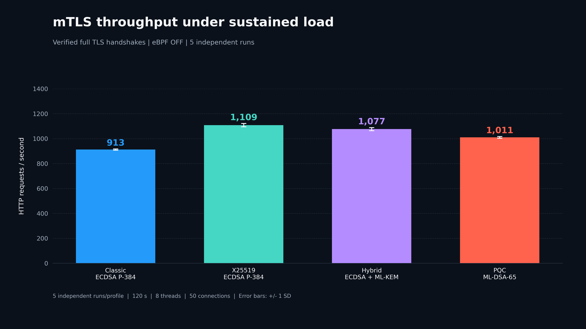
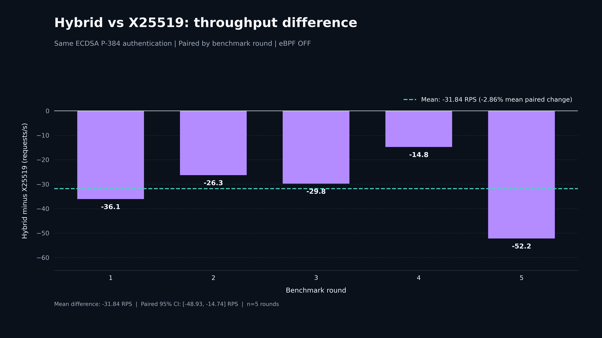
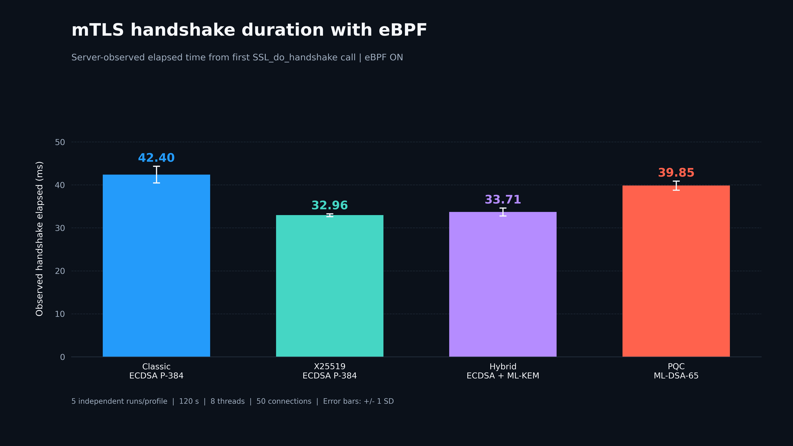
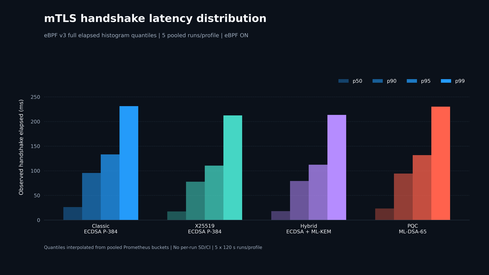

# Mutual TLS: a four-profile classical, hybrid and post-quantum study

**November 2026 validated campaign** — a separate extension of [Post-Quantum TLS: Beyond the Handshake](../README.md). The main repository's non-mTLS HTTPS/PQC campaign and every non-mTLS figure and result remain unchanged.

> **Key result:** with the *same ECDSA P-384 server/client authentication*, hybrid X25519MLKEM768 key establishment delivered **1,076.88 HTTP requests/s**, compared with **1,108.71 requests/s** for X25519: **2.87% lower throughput** in this specific sustained-load experiment. This is a system-level observation on a saturated testbed, **not** an isolated or universal ML-KEM overhead.

## Why this dataset supersedes the October mTLS pilot

The earlier three-profile, nine-run mTLS pilot did not verify the server certificate in its original custom wrk implementation: disassembly showed `SSL_CTX_set_verify(..., SSL_VERIFY_NONE)`. It also lacked a control combining X25519 key exchange with the same ECDSA credentials as the hybrid profile; its eBPF elapsed metric represented the final successful `SSL_do_handshake()` call rather than necessarily the whole observed handshake interval. The original pilot remains recoverable from Git history, but **it must not be cited as validated peer-authenticated mTLS performance**.

The new campaign has **4 profiles × 5 runs × 2 observer modes = 40 measured runs**, each 120 seconds. A new wrk build was validated with `SSL_VERIFY_PEER`, an explicit trust chain and hostname verification (`SSL_set1_host`); wrong-CA testing rejected connections. Apache required a valid client certificate; trials with no client certificate or an unauthorized client CA failed as expected. No TLS session resumption was reported. The observed successful handshake counts in wrk and the eBPF exporter matched in all instrumented runs, with zero parser errors.

These negative tests were performed in the lab; their sensitive raw logs and certificate material are not distributed.

## TLS profile matrix

| Identifier | Key establishment | Server authentication | Client authentication | Role |
|:--|:--|:--|:--|:--|
| `mtls-classic` | NIST `secp384r1` | ECDSA P-384 | ECDSA P-384 | Classical P-384 control |
| `mtls-x25519` | `X25519` | ECDSA P-384 | ECDSA P-384 | Direct comparator for hybrid |
| `mtls-hybrid` | `X25519MLKEM768` | ECDSA P-384 | ECDSA P-384 | Hybrid key-establishment experiment |
| `mtls-pqc` | `X25519MLKEM768` | ML-DSA-65 | ML-DSA-65 | Hybrid KEX with post-quantum authentication |

**PQC does not mean a purely post-quantum KEX here:** the ML-DSA-65 profile still uses the hybrid X25519/ML-KEM key agreement. The last row changes *authentication and its certificate chain* as well as using the hybrid KEX, so it does not isolate the ML-DSA primitive.

X25519 and Hybrid used matching ECDSA certificates, CA/trust, TLS 1.3 and `TLS_AES_256_GCM_SHA384` configuration; the negotiated group was the controlled difference. The request target was `/` and requests specified `Connection: close`.

## Main results — eBPF OFF (un-instrumented performance)

| Profile | Mean RPS | SD (5 runs) | Mean HTTP latency | Mean server CPU busy |
|:--|--:|--:|--:|--:|
| Classic P-384 | 912.68 | 4.69 | 30.07 ms | 99.52% |
| **X25519** | **1,108.71** | 13.18 | 34.84 ms | 99.48% |
| **Hybrid X25519MLKEM768** | **1,076.88** | 11.99 | 34.13 ms | 99.47% |
| ML-DSA-65 authentication | 1,010.50 | 6.85 | 26.22 ms | 99.49% |

The paired Hybrid-minus-X25519 difference over matched round numbers was **−31.84 RPS** (paired t-based 95% confidence interval **[−48.93, −14.74] RPS**, n=5). Hybrid was lower in all five matched rounds. These are observational, small-sample results; paired rounds were not simultaneous tests.

## eBPF ON — server-observed handshake elapsed time

| Profile | Mean server-observed elapsed | Mean RPS with observer ON | OFF → ON throughput reduction |
|:--|--:|--:|--:|
| Classic P-384 | 42.403 ms | 873.81 | 4.26% |
| X25519 | 32.959 ms | 1,049.23 | 5.37% |
| Hybrid X25519MLKEM768 | 33.708 ms | 1,026.89 | 4.64% |
| ML-DSA-65 authentication | 39.848 ms | 950.76 | 5.91% |

The eBPF measurement is elapsed **server-observed time from the first `SSL_do_handshake()` invocation on an SSL object to its successful completion**; it is not end-to-end client TLS setup, and it is not pure cryptographic CPU time. Means shown above are arithmetic means of five run-level histogram means. The additional p50/p90/p95/p99 figure uses interpolated *pooled* Prometheus buckets, not an average of run-level percentiles, and has no per-run confidence interval.

The observer ON/OFF difference includes the **whole exporter, event parsing, profiling and monitoring activity**, not solely the cost of a BPF probe. At roughly 99.5% server CPU utilization these differences must not be used to infer how the same algorithms perform without CPU saturation.

## Figures

The current campaign has nine matching-theme figures (eight offline figures plus one pooled eBPF percentile figure), produced originally on the benchmark client in PNG, SVG and PDF. For a compact Git tree, **PNG and SVG** are sufficient; PDF can be regenerated from the script.

| Figure | Interpretation |
|:--|:--|
| 01 | Throughput, observer OFF, ±1 SD |
| 02 | Server-observed completed handshake elapsed, observer ON, ±1 SD across runs |
| 03 | Mean HTTP latency from wrk, excludes TLS connection setup |
| 04 | RPS over the five independent rounds |
| 05 | Host-level CPU utilization (not process-specific) |
| 06 | Total observed observer ON/OFF throughput effect |
| 07 | Paired Hybrid-minus-X25519 throughput difference, 95% CI |
| 08 | Throughput with observer ON versus OFF |
| 09 | Pooled histogram p50/p90/p95/p99; bucket-interpolated, not exact raw-event percentiles |

## Reproducibility and files

- [40-run, sanitized numeric dataset](data/results.csv) — primary source for 01–08.
- [Campaign runner](scripts/run-mtls-campaign.py) — sanitized, parameterized template for the already-configured client and observer. The original TLS credentials and endpoint are **never** committed.
- [Plot script](scripts/plot-mtls-campaign-dark.py) — creates figures 01–08 from the CSV.
- [Pooled histogram script](scripts/plot-mtls-ebpf-percentiles-dark.py) — validates historical exporter counter agreement before generating figure 09. This requires the matching histogram snapshot, unavailable in the ordinary results.csv.
- [Offline consistency checker](scripts/verify-campaign.py), [measurement methodology](docs/methodology.md), [observability semantics](docs/observability.md) and [security/privacy notes](docs/security.md).
- [eBPF v3 probe source](scripts/observability/tls_handshake_v3.bt) — timestamp-corrected and minimized event stream. The deployed exporter was independently adapted for the COMPLETE event, in addition to the probe.

To generate 01–08 from the repository root:

~~~bash
python3 -m venv .venv
.venv/bin/pip install -r mtls/requirements.txt
.venv/bin/python mtls/scripts/verify-campaign.py
.venv/bin/python mtls/scripts/plot-mtls-campaign-dark.py --csv mtls/data/results.csv
~~~

For figure 09, a fresh exporter scrape **cannot** be substituted for the campaign histogram. Only the original validated pooled buckets (or an archived compatible snapshot) can reproduce its percentiles.

## Interpretation boundaries

- HTTP latency reported by wrk **excludes TLS setup**.
- CPU near 100% means a saturated-host throughput experiment, **not a primitive cryptography microbenchmark**.
- The Classic-versus-X25519 comparison also changes the classical KEX group; the Hybrid-versus-X25519 comparison is the most directly controlled key-establishment result.
- The observer ON and OFF campaign values are distinct and must not be pooled to claim measurement-free TLS latency.
- The older mTLS campaign had weaker TLS verification and traceability; Git history retains that experiment without confusing it with the new validated results.
- The main non-mTLS November 4 PQC/HTTPS study uses **different TLS configurations and workload assumptions**; never pool or directly rank its throughput against mTLS.

All original raw logs, TLS private keys, internal FQDNs and sensitive certificate paths remain private.
