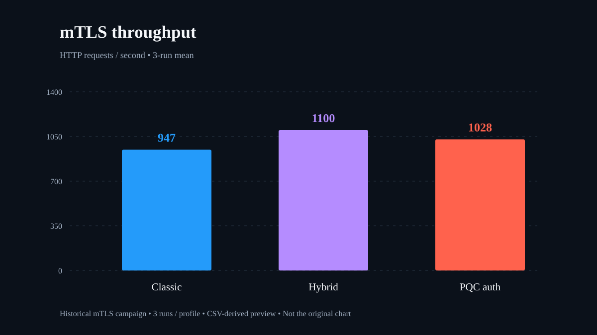
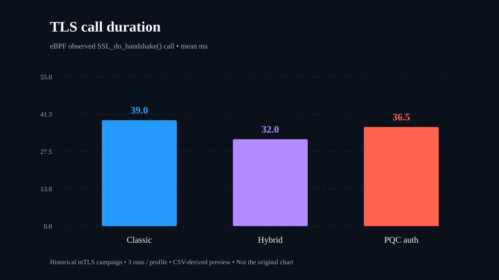
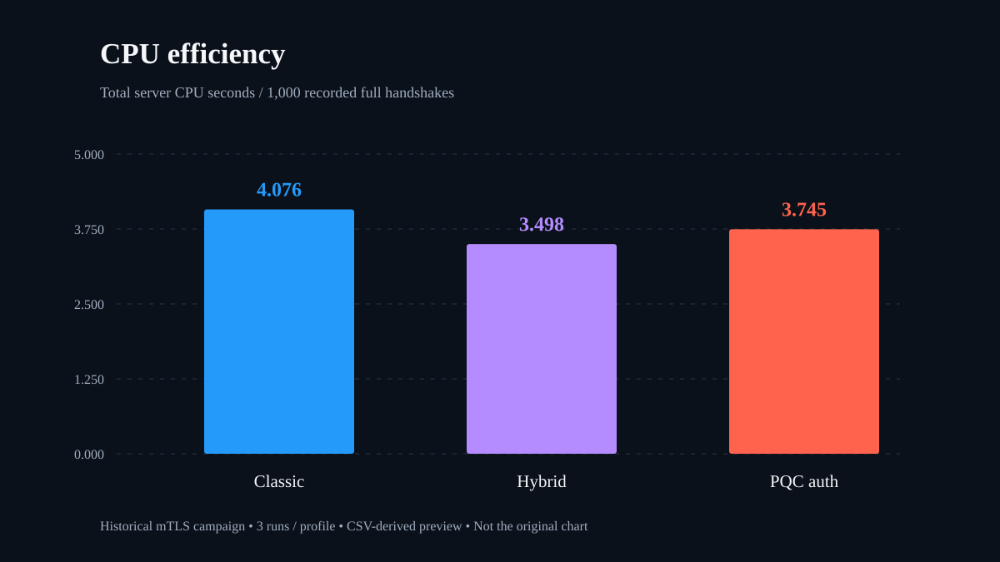

# Post-Quantum Mutual TLS: benchmarking bidirectional authentication

**An independent October 2026 mTLS campaign** associated with [Post-Quantum TLS: Beyond the Handshake](../README.md). It does **not** replace or alter the repository's November 4 server-authenticated HTTPS study.

> **Provenance:** This initial GitHub contribution contains run-level measurements transcribed from the uploaded historical `wrk` logs and the provided eBPF/CPU summary CSVs. The original sanitized logs, original Matplotlib plotting code and 24 original PNG/SVG/PDF chart files are preserved in a separate [prepared review package](docs/missing-artifacts.md), but are **not yet committed to this branch**. These results are a documented historical experimental record, not a live rerun.

## TLS 1.3 profiles

| Profile | Lab port | Server cert | Client cert | Key establishment |
|---|---:|---|---|---|
| Classic | 13443 | ECDSA P-384 | ECDSA P-384 | secp384r1 |
| Hybrid | 15443 | ECDSA P-384 | ECDSA P-384 | X25519MLKEM768 |
| PQC authentication | 14443 | ML-DSA-65 | ML-DSA-65 | X25519MLKEM768 |

The so-called PQC profile uses post-quantum **authentication** and **hybrid** key exchange. X25519 remains classical; this is not a pure post-quantum key exchange.

Nine 120-second executions: 8 `wrk` threads, 50 concurrent connections, 3 runs/profile and a 4-vCPU Apache server. Client logs report TLS 1.3, the expected negotiated group and zero resumed sessions.

## Measured results

| Metric, mean across 3 runs | Classic | Hybrid | PQC auth |
|---|---:|---:|---:|
| HTTP requests/second | 946.68 | 1100.47 | 1027.75 |
| Client-observed HTTP p99 (ms) | 161.25 | 206.24 | 161.07 |
| eBPF-observed `SSL_do_handshake()` call mean (ms) | 39.01 | 31.99 | 36.51 |
| eBPF call p50 (ms) | 26.86 | 17.76 | 22.06 |
| eBPF call p99 (ms) | 198.99 | 200.80 | 213.14 |
| Server CPU utilization (%) | 96.57 | 96.34 | 96.33 |
| Server CPU-s / 1,000 recorded full handshakes | 4.076 | 3.498 | 3.745 |

**Hybrid delivered 16.25% more requests/second than Classic in this setup, but also 27.9% higher client-observed HTTP p99 latency.** More throughput does not imply better tail latency. The PQC-authentication profile delivered 8.56% higher throughput than Classic.

**Important:** Classic uses secp384r1 while the other profiles use X25519MLKEM768. This test does **not** isolate the marginal effect of ML-KEM. The results are system-level observations with near-saturated CPU, not intrinsic algorithm speed rankings.

## Figures: CSV-derived previews

The SVG previews below were independently generated from the numeric CSV committed in this branch. The eight **original** dark-theme charts from the experiment have not yet been transferred to GitHub.





[All 8 SVG previews](figures/preview/) · [Run-level measurements](data/runs.csv) · [Summary CSV](data/summary.csv)

## Check and extend

```bash
python3 mtls/scripts/verify_data.py
python3 -m venv .venv && source .venv/bin/activate
pip install -r mtls/requirements.txt
python3 mtls/scripts/plot_from_csv.py
```

The check validates **internal CSV consistency only**, not independently verified eBPF probes, OpenSSL certificate verification, or full TLS handshake correctness. The plotting script produces eight PNG/SVG/PDF figures from the committed CSV in `mtls/figures/generated/` (ignored by Git). Read the [methodology and limitations](docs/methodology.md) and [next experiments](docs/next-experiments.md) before interpreting the findings.

**No private keys, credentials or internal lab names are included.**
